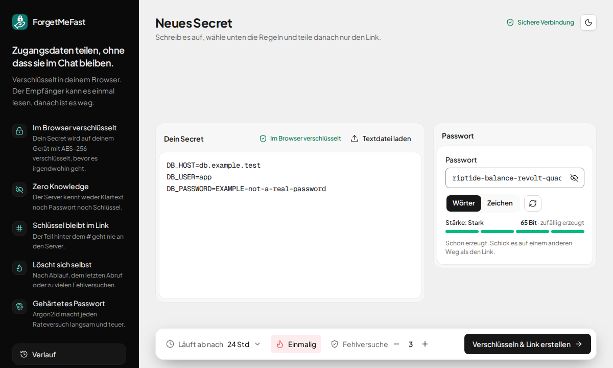
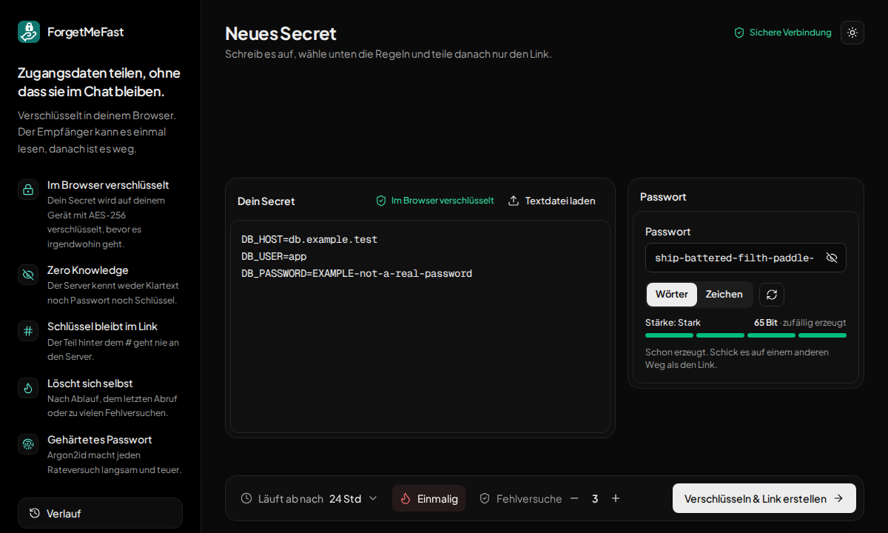
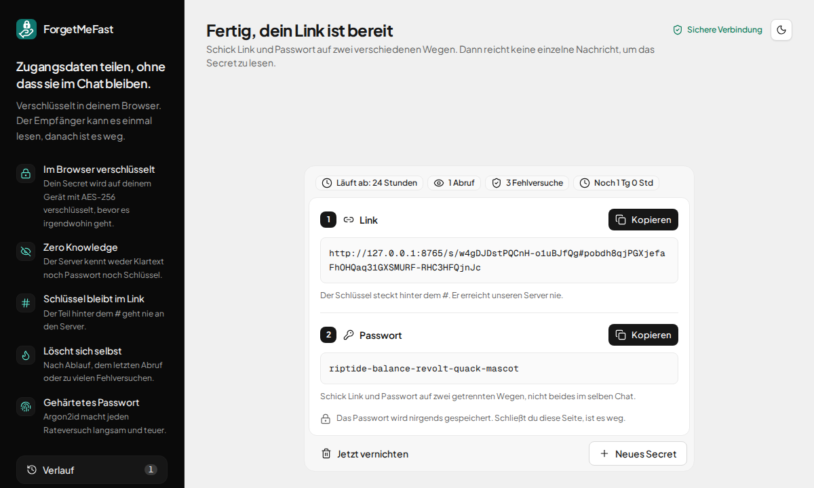
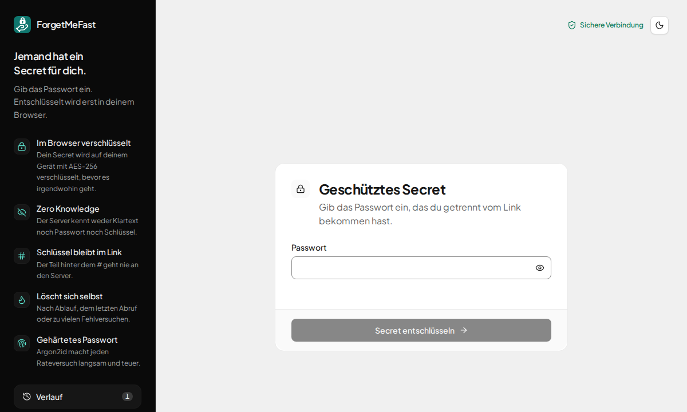

# ForgetMeFast

Secrets einmalig und Ende-zu-Ende-verschlüsselt teilen. Self-Hosted, ohne Accounts, ohne Tracking.

> **Demo-Projekt.** ForgetMeFast ist ein Demonstrationsprojekt, das an einem Tag mit agentischer Entwicklung entstanden ist
> (Claude Code, rund sechs Stunden zwischen dem ersten und dem letzten Commit, 75 Commits am 2026-11-04 und danach weitergepflegt). Es zeigt
> eine Arbeitsweise: Spezifikation zuerst, Quellen statt Behauptungen, Tests und Gegenproben, CI und ein gehärtetes Container-Image. Es ist
> **kein geprüftes Produkt**; die Kryptografie wurde nicht extern begutachtet (siehe [Bekannte Grenzen](#bekannte-grenzen) und
> [`SECURITY.md`](SECURITY.md)). Wer es mit echten Geheimnissen betreiben will, prüft das Protokoll selbst.
> Lizenz: [MIT](LICENSE).

## Idee

ForgetMeFast ist eine selbst gehostete Webapp, mit der man Passwörter, API-Keys und Zugangsdaten einmalig weitergibt, ohne
dass sie im Chat- oder Mailverlauf liegen bleiben. Der Browser verschlüsselt, der Server speichert nur Ciphertext und
Metadaten und vernichtet das Secret nach Ablauf, zu vielen Abrufen oder zu vielen Fehlversuchen. Den Link bekommt der
Empfänger über einen Kanal, das Passwort über einen anderen. Das Protokoll steht in [`docs/SPEC.md`](docs/SPEC.md), die
Bytes in [`docs/CRYPTO-NOTES.md`](docs/CRYPTO-NOTES.md).

## So sieht es aus


| Erstellen (hell) | Erstellen (dunkel) |
|---|---|
|  |  |
| **Link und Passwort** | **Empfänger** |
|  |  |

Die Bilder entstehen aus der echten Anwendung mit erfundenen Beispielwerten (`npm run docs:media`, braucht `ffmpeg` für die GIF).

## Start

Voraussetzungen: PHP 8.3 mit `sqlite3`, `pdo_sqlite`, `mbstring`, `intl`; Composer; Node (Version in `.nvmrc`).

```bash
composer install
npm install
cp .env.example .env
php artisan key:generate
touch database/database.sqlite
php artisan migrate
composer dev        # App (127.0.0.1:8000), Vite (127.0.0.1:5173) und Scheduler
```

Scheduler: `composer dev` startet ihn mit. In Produktion braucht es einen Cron-Eintrag
`* * * * * php /pfad/artisan schedule:run`, der `secrets:prune` jede Minute ausführt.

Prüfen:

```bash
composer check      # Pint, Pest, composer audit
npm run check       # Typecheck, Vitest (mit Abdeckungsschwelle), Build, npm audit
npx playwright install chromium   # einmalig
npm run e2e         # Playwright gegen das Build, mit Klartext-Scan
```

`npm run e2e:dev` führt dieselben Tests gegen den Vite-Dev-Server aus. Nicht gleichzeitig mit `composer dev` (Port 5173).

Hinweis: Ist `COMPOSER_IGNORE_PLATFORM_REQS` gesetzt, kann Composer Pakete installieren, die eine neuere PHP-Version
verlangen. Vor Composer-Befehlen zurücksetzen (siehe [`docs/PROJECT-FACTS.md`](docs/PROJECT-FACTS.md)).

**Produktion:** `APP_ENV=production`, `APP_DEBUG=false` (Debug-Seiten zeigen Request-Daten), Betrieb nur über **HTTPS**
(ohne sichere Verbindung steht Web Crypto nicht zur Verfügung und die App weigert sich zu verschlüsseln). Der Webserver
muss die Sicherheits-Header auch für statische Dateien unter `public/` setzen (`Content-Security-Policy`, `no-store`,
`Referrer-Policy`, `X-Content-Type-Options`, `X-Robots-Tag`); das macht Laravel nur für Antworten der App.

**Hinter einem Reverse Proxy** (nginx, Caddy, Traefik) `TRUSTED_PROXIES` in `.env` auf dessen Adresse(n) setzen, sonst sieht die App
nur die Adresse des Proxys, und alle Besucher teilen sich ein einziges Throttle-Kontingent (20 Anlegevorgänge pro Stunde für
alle). Nur Proxys eintragen, die ihr kontrolliert: Von ihnen wird `X-Forwarded-For` übernommen, von sonst niemandem. Zusätzlich im
Proxy die Body-Größe begrenzen (`client_max_body_size 128k;` in nginx); die App lehnt größere Bodies selbst mit 413 ab, aber
das Lesen soll gar nicht erst bis dorthin gehen. IPv6-Adressen zählen im Throttling nach dem /64-Präfix.

## Betrieb mit Docker

CI baut das Image, prüft es mit einem Rauchtest und Trivy und schiebt es auf `main` und bei Versions-Tags nach
`ghcr.io/<owner>/<repo>`. Lokal bauen: `docker build -t forgetmefast .`

```bash
export APP_KEY="$(docker run --rm forgetmefast php artisan key:generate --show)"   # einmal erzeugen und aufbewahren
docker compose up -d                                                                # docker-compose.yml: Image, Volume, gehärtet
```

- **HTTPS** muss ein Reverse Proxy davor beenden; der Container spricht HTTP auf Port 8080 (nur an `127.0.0.1` gebunden).
  Ohne HTTPS stellt der Browser Web Crypto nicht bereit.
- **`TRUSTED_PROXIES`** auf die Adresse des Proxys setzen (siehe oben), sonst teilen sich alle Besucher ein Throttle-Kontingent.
- **Daten** liegen als SQLite in `/data` (Volume). Das Image selbst ist unveränderlich; die Compose-Datei startet es mit
  schreibgeschütztem Dateisystem, ohne Capabilities und ohne neue Rechte, als Benutzer `www-data`.
- **Inhalt des Images:** FrankenPHP (Caddy mit PHP 8.3), `--no-dev`, Basis-Images auf einen Digest festgenagelt. Caddy setzt die
  Sicherheits-Header auch für statische Dateien und liefert Quelltext, `.env` und Dotfiles nie aus. Der Aufräumjob läuft jede
  Minute im Container. Ein Zugriffsprotokoll mit Adressen gibt es nicht.
- **Nicht enthalten:** TLS, Backups, Updates. Das bleibt dem Betreiber.

## Eingesetzte KI-Werkzeuge und Vorgehen

Gebaut wurde mit **Claude Code** und den Skills aus dem Marketplace `Rene-Roscher/skills` (`core`, `laravel`, `web`,
`delivery`, `api`, `guardrails`); Dokumentation zu Bibliotheken kam über Context7 und die Quellen selbst (RFCs, MDN, OWASP).

Was der Agent gebaut hat: Laravel-Gerüst, Krypto-Modul, API, Oberfläche, Tests, CI und Dokumentation, jeweils nach einem
Plan, mit Test vor Code und mit einer Gegenprobe pro Schutzmaßnahme.

Was der Maintainer entschieden und geprüft hat: den Stack und das Protokoll (`docs/SPEC.md`), die Setup-Entscheidungen
([ADR 0003](docs/adr/0003-setup-decisions.md): keine Accounts, keine Cookies, nativer Dev-Stack), die Argon2id-Bibliothek
([ADR 0002](docs/adr/0002-argon2id-library.md)), alle Protokolldetails, die die Spec offenließ
([ADR 0004](docs/adr/0004-crypto-module-protocol-details.md)), die Oberfläche (Gestaltung mit gemessenen Kontrasten,
[ADR 0005](docs/adr/0005-ui-components-i18n-and-palette.md) bis [0007](docs/adr/0007-sonner-prefs-text-files-and-no-review.md)).

Ehrliche Einschränkungen beim Vorgehen:
- Der Plan fürs Krypto-Modul bekam eine unabhängige gegnerische Prüfung (ein Prüfer sah nur Plan, Spec und Code). Sie fand
  zwölf Punkte, die der Agent einzeln nachprüfte und einarbeitete, darunter einen Fehler im Agenten-Plan.
- Für die Pläne zu API und Oberfläche gab es keine eigene gegnerische Prüfung. Stattdessen stehen ein Paralleltest mit echten
  Prozessen und die E2E-Tests dahinter.
- Die Krypto-Entscheidungen wurden einzeln vom Maintainer beantwortet und stehen in ADR 0004. Eine externe Prüfung der Krypto gab es nicht.

## Architekturentscheidungen

Protokoll v1 in einem Satz je Baustein, mit Quelle. Die genauen Bytes stehen in
[`docs/CRYPTO-NOTES.md`](docs/CRYPTO-NOTES.md), die Begründungen für Abweichungen in den [ADRs](docs/adr/).

- **Zufall:** `id`, Link-Key, Salt, IV und Verwaltungstoken kommen aus `crypto.getRandomValues`, weil es die vom Browser
  bereitgestellte kryptografische Zufallsquelle ist (W3C Web Cryptography API). `Math.random` ist im Modul per Test verboten.
- **Link-Key im Fragment:** Der Schlüssel steht hinter dem `#`, weil der Browser das Fragment nicht an den Server sendet (MDN
  "URI fragment"; RFC 3986 §3.5). Nachgeprüft: Der E2E-Test sucht den Link-Key in allen Anfragen, im Server-Zugriffsprotokoll,
  in den Logs und in der Datenbank und findet ihn nirgends.
- **Argon2id (m=19 MiB, t=2, p=1):** Es macht das Raten des Passworts teuer und ist die erste Wahl von OWASP (OWASP Password
  Storage Cheat Sheet, gelesen 2026-11-04; RFC 9106). Bibliothek `@noble/hashes`: [ADR 0002](docs/adr/0002-argon2id-library.md).
- **HKDF-SHA-256 mit getrennten Labels:** Aus Link-Key und Passwort entstehen zwei unabhängige Schlüssel, einer zum
  Verschlüsseln, einer als Zugangsnachweis (RFC 5869, Testvektoren A.1 bis A.3 im Test).
- **AES-256-GCM mit AAD:** Verschlüsselung mit Manipulationsschutz; der Kopf (Version, id, KDF, Salt) steckt in der AAD, damit
  Austausch und Downgrade auffallen (NIST SP 800-38D). Ein frischer Schlüssel je Secret, der IV wird nur einmal je Schlüssel benutzt.
- **Auffüllen auf 1, 4, 16, 64 KiB:** verbirgt die Länge des Secrets (`docs/SPEC.md`).
- **Verifier und Vorrang der Reservierung:** Der Server speichert nur SHA-256 des Zugangsnachweises. Er reserviert einen
  Versuch per bedingtem `UPDATE` **vor** dem Vergleich, sonst umgehen parallele Anfragen das Limit. Belegt mit 50 echten,
  gleichzeitig startenden Prozessen; eine naive Fassung ließ 50 statt 3 Fehlversuche durch.
- **`GET /s/{id}` ändert nichts und fragt nichts ab:** Link-Vorschauen und Bots verbrennen kein Secret. Test: keine
  Datenbankabfrage, Zähler unverändert.
- **Einheitliche Antwort "nicht verfügbar":** unbekannt, abgelaufen, vernichtet, verbraucht und falsches Verwaltungstoken
  liefern Byte für Byte dieselbe 404, damit sie nichts über die Existenz verraten.
- **Strikte CSP, keine Cookies:** `default-src 'none'`, Skripte nur vom eigenen Ursprung, Styles mit Nonce; kein Cookie wird
  gesetzt (Test) ([ADR 0003](docs/adr/0003-setup-decisions.md); MDN "Content-Security-Policy").

## Qualitätssicherung

Stand 2026-11-04, alles lokal gelaufen:

- **Pest:** 168 Tests (Validierung, Zähler, Vernichtung, einheitliche Antworten, Header, Cookies, Throttling, Architekturregeln,
  Schema ohne Klartext- und IP-Spalten, Logs ohne Marker, drei Paralleltests mit je 50 Prozessen).
- **Vitest:** 206 Tests für Krypto-Modul und alle Logik-Module der Oberfläche (Verlauf, Regeln, Textdatei, Fragment, Meldungen), Zeilenabdeckung 99 % bei erzwungenen 95 %; RFC-5869-Vektoren,
  RFC-9106-Vektor, ein unabhängig erzeugter Protokollvektor, AAD-Test je Feld, statische Prüfung auf Speicher, Netzwerk und `console`; die drei i18n-Tests (Syntax, Parität, Nutzung) und ein Wächter gegen Emojis.
- **Playwright:** 52 Tests im echten Chromium: ganzer Ablauf in zwei Browser-Kontexten, Fehlversuche, Vernichten,
  der gesendete Request ohne Klartext, Passwort und Link-Key, gemerkte Regeln, Textdatei laden, Hell/Dunkel-Umschalter ohne Flackern, CSP ohne Verstöße, Argon2id im Worker, **Klartext-Scan** über Datenbank, Logs und
  Zugriffsprotokoll mit Positivkontrolle, gemessener Kontrast, Rahmen, Fokus und Überlauf in hell und dunkel.
- **Gegenproben:** Jede Schutzmaßnahme wurde einmal gegen eine absichtliche Verletzung rot gesehen (Mutation), auch die
  Messungen selbst.
- **CI:** [`.github/workflows/ci.yml`](.github/workflows/ci.yml) mit auf Commit-SHAs gepinnten Actions, Lesezugriff und
  `zizmor`. **Sie ist noch nie auf GitHub gelaufen**, weil nichts gepusht wurde.

## Bekannte Grenzen

| Angreifer hat | Ergebnis |
|---|---|
| Datenbank oder Server-Logs (neugieriger Betreiber) | Nur Ciphertext und Verifier. Ohne den Link-Key nicht lesbar, Offline-Angriff aufs Passwort scheitert am 256-Bit-Key. |
| Nur den Link (z. B. aus einem Chatverlauf) | Kein Offline-Angriff möglich, weil der Server den Ciphertext erst nach dem Nachweis herausgibt. Online nur `max_attempts` Versuche. |
| Link **und** Serverdaten | Offline-Angriff aufs Passwort. Argon2id bremst, die Passwortstärke entscheidet. |
| Nur das Passwort | Nutzlos ohne Link. |
| Kompromittierter Server liefert manipuliertes JavaScript | **Nicht abgedeckt.** Das Grundproblem von Web-E2EE. Gemildert durch strikte CSP, minimale Abhängigkeiten, Open Source. |
| Wer den Link hat, will nur zerstören | Möglich (3 Fehlversuche). Vertraulichkeit geht vor Verfügbarkeit. |

Weitere ehrliche Grenzen: Chat-Anbieter sehen den **kompletten Link** (er ist Nachrichtentext), deshalb muss das Passwort über einen anderen Kanal gehen. Der Server sieht Metadaten (Zeitpunkt, IP-Hash im Throttling, Größen-Bucket). Browser-Verlauf und Erweiterungen sehen das Fragment. Keine externe Prüfung der Krypto. Sicherheitseigenschaften beim richtigen Namen nennen: Vertraulichkeit gegenüber dem Server, Integrität durch AEAD, keine Aussage zu Forward Secrecy.

Dazu kommen diese, die der Agent selbst gefunden hat:

- **Kein Audit.** Die Argon2-Implementierung von `@noble/hashes` ist ausdrücklich nicht im Umfang des Cure53-Audits
  der Bibliothek. Eine externe Prüfung dieses Projekts gab es nicht.
- **Unicode-Version.** Das Passwort wird mit NFKC normalisiert (`String.prototype.normalize`). Das hängt von der
  Unicode-Version der Laufzeit ab (Node 24.11.1: Unicode 16.0); seltene Zeichen könnten in einem anderen Browser einen anderen
  Schlüssel ergeben. Nicht gemessen.
- **Mobilgeräte.** Argon2id braucht im Desktop-Chromium etwa 100 ms; auf Handys nicht gemessen.
- **Löschen ist kein Überschreiben.** SQLite läuft mit `secure_delete`, das garantiert aber kein physisches Überschreiben
  (Dateisystem, Snapshots). Harmlos, weil nur Ciphertext dort liegt.
- **Statische Dateien.** Die Header setzt Laravel nur für seine eigenen Antworten; für `public/` muss es der Webserver tun. Im
  Container-Image tut das Caddy (Rauchtest in der CI prüft es); bei anderem Betrieb ist es Sache des Betreibers.
- **Anlegen ist nicht idempotent.** Geht die Antwort verloren, versucht der Nutzer es erneut und es entsteht ein zweites
  Secret; das erste läuft ab.
- **Gemeinsame IP.** Das Throttling zählt je gesalzenem IP-Hash (IPv6 nach /64). Viele Nutzer hinter derselben Adresse teilen sich das
  Limit; hinter einem Reverse Proxy muss `TRUSTED_PROXIES` gesetzt sein, sonst gilt das für alle.
- **Browser-Verlauf und Erweiterungen** sehen das Fragment, bevor die Seite es entfernt.
- **Im Browser gespeichert wird:** die Wahl Hell oder Dunkel (`fmf-theme`), deine zuletzt gewählten Regeln (`fmf-prefs`: Ablauf, Abrufe, Fehlversuche, Einmalig, Art des Passworts) und dein Verlauf (`fmf-history`) mit Link, Verwaltungstoken und Ablauf deiner eigenen Secrets, **nie** Passwort oder Klartext (ADR 0006). "Verlauf leeren" löscht ihn. Kein Cookie, nichts davon erreicht den Server.
- **Zwischenablage.** Kopiert der Nutzer das Secret, liegt es dort, bis er es ersetzt.

## Lizenzen und Quellen

- Icons: [Lucide](https://lucide.dev) (`lucide-vue-next`), ISC-Lizenz. Das Logo (eine Hand, die ein Schloss trägt) nutzt die Handform von Lucide "hand-heart"; das Schloss ist eigen. Meldungen: [vue-sonner](https://github.com/xiaoluoboding/vue-sonner) (MIT).
- Oberfläche: [Reka UI](https://reka-ui.com) (MIT), [vue-i18n](https://vue-i18n.intlify.dev) (MIT), Palette Tailwind teal; Gründe und Abwägungen in [ADR 0005](docs/adr/0005-ui-components-i18n-and-palette.md).
- Schriften Plus Jakarta Sans und Geist Mono: SIL Open Font License 1.1 (über `@fontsource-variable/*`).
- EFF Large Wordlist (Passphrasen): © Electronic Frontier Foundation, Creative Commons Attribution 4.0 International
  (CC BY 4.0), laut https://www.eff.org/copyright; Quelle https://www.eff.org/dice. Geändert: Würfelzahlen entfernt, als
  TypeScript-Array übernommen (`resources/js/crypto/eff-large-wordlist.ts`).
- Quellen (Zahlen und Zitate am 2026-11-04 selbst gelesen): [MDN URI fragment](https://developer.mozilla.org/docs/Web/URI/Reference/Fragment),
  [RFC 3986](https://www.rfc-editor.org/rfc/rfc3986), [OWASP Password Storage Cheat Sheet](https://cheatsheetseries.owasp.org/cheatsheets/Password_Storage_Cheat_Sheet.html),
  [RFC 5869](https://www.rfc-editor.org/rfc/rfc5869), [RFC 9106](https://www.rfc-editor.org/rfc/rfc9106),
  [NIST SP 800-38D](https://csrc.nist.gov/pubs/sp/800/38/d/final), [W3C Web Cryptography API](https://www.w3.org/TR/WebCryptoAPI/).
